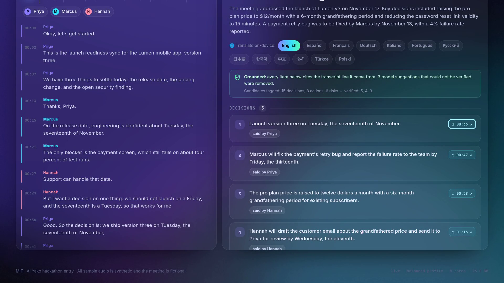

# Pocket Minutes

**Meeting minutes that never leave your device.** Drop in a recording; a local AI transcribes it, tells the speakers apart, writes the decisions / action items / risks (each one tied to the exact second it was said), answers questions about the meeting, translates the minutes — and hands you an **Offline Receipt** that shows what ran and that nothing went online.

Built for the **AI Yako** hackathon (DoraHacks) on **Tether QVAC** — track *Cloud → Pocket*: a cloud product (AI meeting notes) moved onto the device.

| | |
|---|---|
| **Hosted demo (replay of a real local run)** | https://pocket-minutes-sama-5806.vercel.app |
| **Demo video** | [`docs/demo.mp4`](docs/demo.mp4) — the real app recorded inside a no-network sandbox |
| **Licence** | MIT |

> **Read this first — what the hosted page is.** QVAC runs native inference on *your* machine; it cannot run inside a web page or on a serverless host. The Vercel URL therefore serves a **recorded replay** of a real run of the local app (clearly bannered "RECORDED REPLAY"). **No cloud AI is involved anywhere**: the hosted page computes nothing. The offline AI feature only exists in the local app (`npm start`).



## What it does

1. **Listen** – `whisper.cpp` (QVAC `WHISPER_EN_BASE_Q8_0`) produces an instant draft transcript.
2. **Who said what** – `MOSS-Transcribe-Diarize` (Q8) re-transcribes with speaker turns; speaker names are inferred from how people address each other (and can be renamed with one click).
3. **Write minutes (grounded)** – `Qwen3-4B-Instruct (Q4_K_M)` tags decisions / actions / risks in overlapping windows of the transcript, refines each, and a **deterministic verifier** keeps only items whose quoted evidence really appears in the transcript. Every item carries a transcript line number → a **click-to-audio** time chip. Items that could not be grounded are **dropped and counted** in the UI.
4. **Index** – `EmbeddingGemma-300M` embeds 3-line transcript windows for retrieval.
5. **Ask** – RAG over those windows; the answer is streamed, citations (`[12]`) are **verified against the retrieved set**, and an unanswerable question gets "That was not discussed in this meeting."
6. **Translate** – on-device Bergamot NMT (12 languages) for the whole minutes.
7. **Seal receipt** – the **Offline Receipt** (below).

Two profiles: `balanced` (default; the pipeline above) and `lite` (Whisper + Qwen3-1.7B, no diarization; for smaller machines — and visibly weaker, see the benchmark).

## The Offline Receipt (the differentiator)

"Works offline" is usually a claim. Pocket Minutes records evidence while it runs:

* network interfaces that are up, plus a **DNS** probe and a **TCP** probe that are expected to *fail*;
* `/proc/net` sockets **sampled every 200 ms** for the whole job and attributed to *this app's process tree* (the server and the QVAC `bare` worker) through socket inodes in `/proc/<pid>/fd` — so unrelated programs on your machine cannot make it cry wolf;
* models used (name, size, SHA-256 from the QVAC registry), audio hash, timings, peak memory;
* every entry **SHA-256 hash-chained**; the browser **re-verifies the chain with SubtleCrypto**, and a "tamper with one entry" button shows the chain break.

Verdict: `OFFLINE` / `ONLINE` / `EXTERNAL_SOCKETS_SEEN`. It is **evidence, not proof**: a receipt produced by the same machine that ran the job can be forged by someone with root; it is meant to make accidental leaks and silent telemetry visible, not to defend against a malicious host. The app says this in the UI.

`npm run airgapped` goes further: the whole app runs inside a Linux network namespace (`unshare -rn`) that has **no interface except loopback**, so an attempted connection cannot succeed. The recorded replay and the demo video were produced exactly that way.

## Run it locally (offline reproduction)

Requirements: **Node ≥ 22.17** (QVAC SDK requirement), Linux/macOS/Windows with ~8 GB free RAM for `balanced` (see memory note), ~4 GB disk for models. CPU is enough; no GPU needed.

```bash
git clone https://github.com/demir-sama/pocket-minutes && cd pocket-minutes
npm install
npm run models          # the ONLY step that needs internet: caches models to ~/.qvac (balanced + es,fr,de,ja)
                        #   node scripts/download-models.mjs lite     # smaller profile
                        #   node scripts/download-models.mjs balanced es,fr,de,it,pt,ru,ja,ko,zh,hi,tr,pl
npm start               # http://127.0.0.1:4747   (binds to loopback only)
# — now unplug the network, or use the sandbox: —
npm run airgapped       # Linux: same app inside a network namespace with no network at all
```

Open the page, press **Process the sample meeting** (or drop your own audio — it is decoded in the browser and sent only to `127.0.0.1`). Check the **Offline Receipt** tab.

Other commands:

```bash
npm test                # 21 unit tests (node --test): text/WER maths, speaker inference, receipt hash chain, grounding, RAG citation checks, eval matcher, replay schema
npm run bench           # re-measure the benchmark on your machine -> eval/results.{json,md}
npm run build:replay    # (needs a running server) record a new replay session -> public/replay/session.json
npm run video           # re-record docs/demo.mp4 (see scripts/record-video.sh; needs Kokoro TTS for narration, Chrome, ffmpeg)
```

Environment: `PORT` (4747), `POCKET_PROFILE` (`balanced`|`lite`), `POCKET_TMP`, `POCKET_THREADS` (cap on LLM threads).

> **Busy machine tip.** llama.cpp's thread pool spins; if other programs are using several cores it can slow down dramatically (we measured a 4B generation going from ~54 s to >140 s with two cores busy). Setting `POCKET_THREADS` a couple below your core count (e.g. `POCKET_THREADS=6` on 8 cores) removed the slowdown in our test. The demo video was recorded that way because screen capture competes for CPU (the on-screen label shows the speed-up and the real compute time).

### Prove the offline claim yourself

```bash
npm run airgapped                          # prints the namespace: `ip -br addr` shows only `lo`; example.com is unreachable
# in the UI: Offline Receipt → verdict OFFLINE, DNS EAI_AGAIN, TCP ENETUNREACH, 0 external sockets
sudo tcpdump -i any not port 4747 &        # (optional) on a normal run, watch the wire while you process a meeting: silence
```

## QVAC APIs and models used

`@qvac/sdk` **0.22.0** — `loadModel` / `unloadModel`, `transcribe` (Whisper and MOSS-Transcribe-Diarize), `completion` (streaming + JSON-constrained prompts), `embed`, `ragSearch`, `translate` (Bergamot). Models come from the QVAC registry constants; nothing is fetched from anywhere else at run time.

| Stage | Model (QVAC constant) | Size on disk | Licence |
|---|---|---|---|
| Draft ASR | `WHISPER_EN_BASE_Q8_0` | 82 MB | Whisper: MIT |
| Diarized ASR | `MOSS_TRANSCRIBE_DIARIZE_Q8_0` | 980 MB | see model card |
| Minutes / Q&A | `QWEN3_4B_INST_Q4_K_M` (lite: `QWEN3_1_7B_INST_Q4`, 1.06 GB) | 2.50 GB | Qwen3: Apache-2.0 |
| Retrieval | `EMBEDDINGGEMMA_300M_Q4_0` | 278 MB | Gemma terms of use |
| Translation | `BERGAMOT_EN_*` (12 directions) | ~30 MB each | see model card |

## Benchmark (measured, not promised)

Sample: `launch-sync`, a **137 s synthetic** meeting (3 voices by Kokoro TTS reading a written script), with a written ground truth. Machine: 8-core Xeon (no GPU), 16.8 GB RAM, QVAC 0.22.0, CPU only. Generated by `npm run bench` ([`eval/results.md`](eval/results.md)).

| Profile | Audio → result | Real-time factor | Peak memory | WER | Speakers | Minutes recall | Minutes precision |
|---|---|---|---|---|---|---|---|
| balanced | 161 s | 1.17× | **8.0 GB** | 0.3 % | 3 / 3 | 11 / 12 (91.7 %) | 10 / 11 (90.9 %) |
| lite | 46 s | 0.34× | 5.0 GB | 0.8 % | 1 (no diarization) | 2 / 12 (16.7 %) | 2 / 5 (40.0 %) |

Honest reading:

* **It is slower than real time on CPU** in the balanced profile (≈ 2.7 minutes for a 2.3-minute meeting here), and **needs ~8 GB of RAM** (the MOSS diarization model dominates). The `lite` profile is quick and light but its minutes are poor — we ship it as an option, not a recommendation.
* The pipeline prompts and the verifier were **developed against this one sample**; the score is therefore *not* a held-out result and is "smoke-level", not a leaderboard claim. Real, noisy, overlapping meetings will be worse.
* The audio is clean TTS speech, which flatters the WER.
* Recall/precision use a deterministic content-word matcher (`src/eval.mjs`), no LLM judge; a model may merge related statements, so matching is many-to-one.
* Cloud tools are **not** benchmarked: they may well be more accurate on hard audio. The trade is accuracy-at-the-margin versus the recording never leaving the device.

## What is real and what is synthetic / mocked

* **Real:** the whole QVAC pipeline, the Offline Receipt and its hash chain, the benchmark numbers, the recorded replay (a real run inside a no-network namespace: 0 external sockets over 803 samples, no model download), the tests.
* **Synthetic:** the sample meeting is **fictional** (a product-launch readiness sync) and its audio is **text-to-speech** (Kokoro, Apache-2.0), generated by `scripts/tts-sample.py`; the demo narration is also Kokoro TTS.
* **Mocked / limited:** the **hosted Vercel page is a replay** — it cannot process new audio and shows recorded transcript/minutes/answers/translations (only the questions and four languages that were recorded are available there). Everything else described above runs only in the local app.
* The Offline Receipt is evidence, not a cryptographic proof of non-exfiltration (see above).

## Project layout

```
src/server.mjs        loopback-only HTTP server: jobs, SSE events, ask (ndjson), translate, receipt, export.md
src/engine/           pipeline.mjs (stages + receipt) · transcribe · speakers · minutes (TAG/REFINE/CHECK) · ask (RAG) · translate · qvac.mjs (SDK wrapper, process-tree RSS)
src/offline/monitor.mjs  interfaces, probes, per-process socket sampling, hash chain
src/eval.mjs, src/util/  scoring, WER, text helpers
public/               the UI (vanilla ES modules, no build step; self-hosted OFL fonts) + replay/ for the hosted demo
scripts/              download-models · bench · build-replay · run-airgapped · record-video · tts-sample
test/                 node --test suites
samples/              the synthetic meeting (script, WAV, timeline)
docs/                 BUIDL.md, demo video, screenshots
```

## Built during the event

All code in this repository was written from scratch for this hackathon (started 28 Oct 2026). Third-party: `@qvac/sdk` (Tether), the models above, `playwright-core` (dev only, for the replay/video tooling), Kokoro TTS (dev only, to synthesize the sample), self-hosted fonts under the SIL OFL.

## Licence

MIT — see [LICENSE](LICENSE). Model weights keep their own licences (see model cards).
